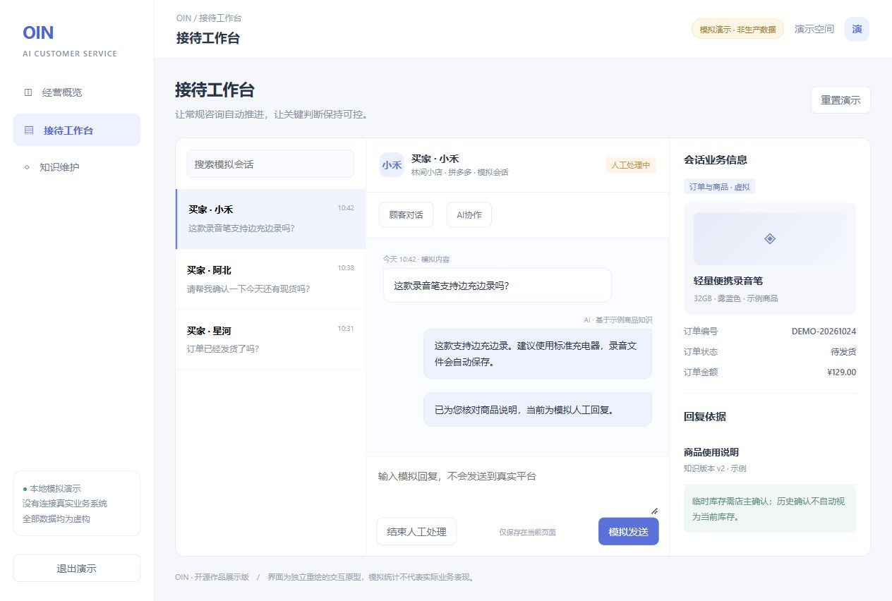
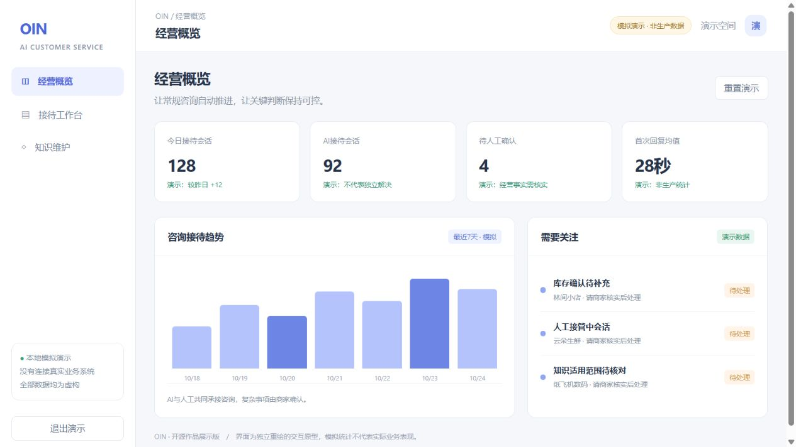

# 电商 AI 客服｜拼多多 · 闲鱼 · 手机端协作

**AI E-commerce Customer Service — Pinduoduo, Xianyu, Web and mobile collaboration.**

OIN 项目公开源码：将商家管理后台、手机端和设备执行端放在同一套产品流程下说明与交付。

面向电商商家的客服与运营协作系统：顾客消息进入会话后，AI结合商品、店铺知识与上下文接待；商家可以补充经营信息、处理需要人工判断的事项并接管回复。产品目标是减少重复接待工作，让少量人工更集中地处理复杂咨询，同时保持回复边界和发送结果可核对。

[快速体验](#快速体验) · [流程与源码导航](docs/architecture.md) · [原系统运行](docs/getting-started.md) · [版本与范围](SOURCE_SNAPSHOT.md)



## 从顾客消息到可控回复

1. **接入消息**：平台连接维护店铺会话，处理长连接、心跳及恢复；管理端查看对话与相关业务信息。
2. **组织回复依据**：结合商品说明、客服政策及会话上下文，按规则和工具调用检索相关知识。
3. **AI与人工分工**：常规问题由AI接待；经营事实不明确或需要人工判断时，由商家补充、确认或接管，内部协作内容与对客回复区分。
4. **发送与恢复**：跟踪生成、发送和恢复状态，避免把“生成回复”直接当成“顾客已收到”；异常进入对应重试或人工处理路径。
5. **维护知识**：商品事实、政策与临时经营信息区分管理，避免将一次人工回答永久套用于所有咨询。

## 一套产品，多个协作入口

本仓库完整保留同一产品体系中的各端源码，按用户角色与服务职责组织，不把手机端作为无关附属项目。

| 使用入口 | 使用者怎样操作 | 与服务端的关系 | 源码 |
| --- | --- | --- | --- |
| 拼多多Web管理端 | 商家查看咨询、管理知识、进行AI协作和人工接管 | 对接拼多多业务API、消息与调度服务 | [拼多多管理系统](systems/pinduoduo/source) |
| 闲鱼Web管理端 | 商家管理账号、会话、订单、商品与接待规则 | 对接闲鱼业务API及实时消息服务 | [闲鱼管理系统](systems/xianyu/source) |
| 闲鱼手机端 | 在手机查看消息、处理订单、管理商品与账号 | 配置服务器后，通过API和WebSocket连接闲鱼服务；是同一闲鱼业务的移动入口 | [React Native / Expo手机端](systems/xianyu/source/xianyu-mobile) |
| Android原生助手 | 手机设备承接平台操作任务，并上报执行结果 | 通过云控制面管理设备绑定、任务和结果回传 | [Android助手与控制面](systems/android-agent/source) |

因此，Web端用于集中管理，闲鱼手机端提供移动管理与接待入口，Android助手承担设备执行。后台、消息通道、调度与控制面按职责使用不同服务端口；对外入口可通过反向代理统一。多端协作不需要将各端源码拆到不同仓库。

这里同时保留真实实现边界：闲鱼手机端接入对应闲鱼后台；Android助手另有控制面。不同平台的顾客身份、消息状态及所有功能是否完全统一，需要按具体接入链路确认，不用“只是端口不同”替代接口与状态核对。

## 重点设计与阅读方向

| 产品问题 | 设计取舍 | 代码阅读方向 |
| --- | --- | --- |
| 模型知道的信息不一定适用于当前店铺 | 商品知识、客服政策与临时经营事实区分 | 商品／客服知识库、知识版本与AI工具调用 |
| 商家补充不应自动变成对客发送 | 区分内部协作、明确发送意图与人工接管 | chat workspace、AI协作和发送操作 |
| 连接恢复不等于消息处理完整 | 保存消息及任务状态，分离接收、处理与发送 | websocket、恢复时钟、Android结果outbox |
| 多入口容易混淆账号与设备 | 控制面管理绑定、授权、任务及执行结果 | Android control-plane与设备端 |

这些机制描述源码中的实现方向；每个平台、版本和异常路径都需分别验收，不将商业交付整体归因于每一项功能。



## 快速体验

Node.js 20+，无需依赖安装、数据库、平台账号或模型密钥：

```bash
git clone https://github.com/Ramenne/pinduoduo-ai-customer-service.git
cd pinduoduo-ai-customer-service
npm run demo
```

打开 **http://127.0.0.1:4173**，使用 **demo / demo-only** 登录。可切换会话、人工接管、模拟发送和查看知识示例。[操作说明](docs/demo.md)

这是本次新增的独立交互原型，截图不是原线上界面；模拟数字不代表真实接待量、回复时延、解决率或节省人力。原系统源码独立保存在systems中。

## 源码结构与技术栈

```text
systems/
  pinduoduo/     拼多多管理端、消息服务、调度与数据库结构
  xianyu/        闲鱼Web管理端、消息服务与调度
    source/xianyu-mobile/  闲鱼手机端：Expo / React Native
  android-agent/ Android原生助手、云控制面、设备绑定与结果回传
demo/            无外部连接的合成交互展示
docs/            架构、版本与开发说明
```

| 子系统 | 主要技术 |
| --- | --- |
| 拼多多 | Vue 3、Pinia、Vite、Python / FastAPI、SQLAlchemy、MySQL、Redis、WebSocket |
| 闲鱼 | React / TypeScript、Vite、FastAPI、MySQL、Redis、Playwright |
| 闲鱼手机端 | Expo、React Native、TypeScript、Zustand、OpenAPI客户端、WebSocket |
| Android助手 | Java / Android、Python控制面、SQLite / PostgreSQL、任务与结果回传 |

## 版本与验证

当前公开的是本地 **2026-10-23导出的三系统源码快照**；拼多多管理源码 **0.1.22**，Android助手 **code66 / 0.19.3-v01**，闲鱼为同日导出源码。后续版本修改不作为此快照已包含的实现。

本次已通过拼多多原前端生产构建，并检查独立展示的登录、人工接管和模拟回复。未在此环境验证真实店铺登录、真实顾客消息收发或整套系统端到端部署。[具体边界](SOURCE_SNAPSHOT.md)

## 开源归属

拼多多与闲鱼后台基于已有开源系统进行集成和定制，并非全部从零自研。保留原项目README、许可与版权声明，OIN相关修改包括AI协作、知识与上下文、接待流程、恢复和集成等；具体以各子系统源码与版本文档为准。

仓库按 [AGPL-3.0](LICENSE) 发布，第三方文件仍按原许可执行。详见 [第三方说明](THIRD_PARTY_NOTICES.md) 和 [安全说明](SECURITY.md)。
